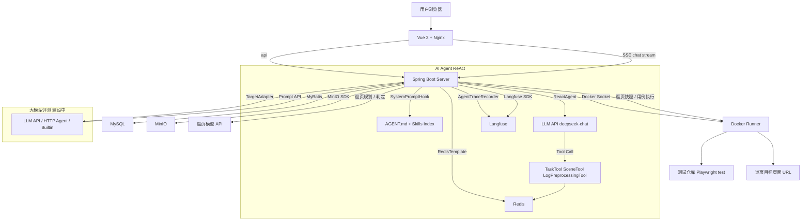

# 易测（智能自动化测试平台）

[](https://github.com/MenXiaoHuan/testplatform/actions/workflows/backend-ci.yml)
[](https://github.com/MenXiaoHuan/testplatform/actions/workflows/frontend-ci.yml)
[](https://github.com/MenXiaoHuan/testplatform/actions)
[](LICENSE)
[](DEPLOYMENT.md)

> 面向 **Node.js / TypeScript / JavaScript `@playwright/test`** 项目的**一站式智能自动化测试平台**。
> 覆盖 **UI 自动化测试**（含 LLM 驱动的巡页巡检，已完成）、**大模型评测**（Prompt 托管 / 目标接入 / 评测集 / 离线评测 / 在线监控已可用），未来扩展**性能测试**和**接口自动化**。

---

## ✨ 功能特性

### 🔧 UI 自动化测试

- **仓库管理**：Git 地址 / 私有仓库凭据（HTTPS Token · SSH Deploy Key · AES-256-GCM 加密）/ 安装命令 / 执行命令模板
- **场景配置**：关联仓库 · 选择分支 / 浏览器 / 测试选择器 / 环境变量 / Cron 定时规则
- **Docker Runner**：短生命周期容器执行任务，隔离测试依赖 / 限制 CPU / 内存 / 网络，不污染宿主机
- **异步任务编排**：手动触发 · 定时触发 · Agent 对话触发 · 任务取消 · 失败重试
- **产物自动归档**：截图 / 视频 / Trace / 阶段日志 自动上传 MinIO · 统一下载 / 分享链接
- **结果解析**：Playwright JSON reporter → 自动入库为结构化用例结果
- **任务状态机**：QUEUED → RUNNING → SUCCESS/FAILED/CANCELED，含 PREPARING / INSTALLING / TESTING / ARCHIVING 阶段日志
- **巡页巡检**：入口页快照 → LLM 规划用例 → 覆盖率补全 → 风险审批 → 用例执行 → 视觉/规则判定；支持定时巡检、Token/时长预算、降级与 90 天证据保留
- **巡页模型配置**：OpenAI 兼容模型接入（Base URL / API Key 加密 / 视觉 / 工具调用 / JSON 输出能力），规划与判定模型独立选择
- **巡页任务详情**：用例录屏、步骤截图、控制台与 DOM 证据；模型日志（规划 / 覆盖率 / 判定原始上下文与输出，仅超级管理员可见）

### 🤖 知知（AI 智能助手）

- **ReAct 循环推理**：Spring AI Alibaba Agent · 思考 → 调用工具 → 观察 → 回答（最多 20 次模型调用熔断）
- **结构化输出**：sections-only（heading / paragraph / list / code / quote / table 六种块）· 省 40-50% Token
- **内置工具集**：TaskTool / SceneTool / RepositoryTool / LogPreprocessingTool
- **Skills 按需加载**：启动时只扫 frontmatter 生成索引，LLM 判断需要时才加载正文（error-analysis / business-knowledge）
- **上下文压缩**：Smart 压缩（LLM 摘要优先，30s 超时 → 规则提取回退）+ Aggressive 压缩
- **全链路 Trace**：Langfuse · 21 个阶段结构化日志 · AOP 拦截真实 Token 用量 · 支持上游 `traceparent` 继承（trace-id 与 Langfuse 双向绑定）· 在「模型评测 → 在线监控」统一查看
- **故障排查**：「帮我分析任务 123 为什么失败了」→ 自动调 TaskTool + LogPreprocessingTool → 输出结构化故障详情
- **SSE 流式**：meta + chunk + complete 事件 · 打字机效果 + fade-in 动画

### 📊 大模型评测

- **Prompt 托管中心**：Agent 通过平台 API 拉取当前 ACTIVE 版本（ETag 缓存 · P95 ≤ 10ms），Langfuse Trace 自动关联
- **通用被评目标**：LLM API · HTTP Agent · 平台内置 Agent，适配器模式统一接口
- **离线评测**：固定评测集批量跑批 · 多评分器叠加（精确匹配 / 规则匹配 / 关键词 / JSON Schema / LLM-as-Judge / Trace 快照）
- **在线评测**：Langfuse 自动采集所有真实生产请求 → 基于 Trace 配置策略 + 自动评分 + 监控聚合（P50/P95 延迟 / Token / 自动评分分布）
- **A/B 实验**：同一份 Prompt 的不同版本对比 · 跨 Target 对比 · 并行执行 · t 检验 p-value 显著性分析（后端能力已具备，前端页面规划中）
- **多租户并发**：双层并发限流 + per-Target 共享隔离 + 扫描抖动 + 三层 Judge 预算墙（日预算 → space 预算 → 分钟级 rateLimit）
- **内置评测集**：MMLU / HumanEval / GSM8K / TruthfulQA 随平台启动自动同步，作为只读基线

### 🏗️ 平台基础设施

- **RBAC 三角色**：Space 内 ADMIN / OPERATOR / VIEWER；平台级超级管理员可跨空间进入、编辑与删除
- **多租户隔离**：所有业务数据通过 `space_id` 关联，后端强制校验
- **审批流程**：自助注册（超管可在界面开关，数据库持久化）→ 自动创建默认 Space → 申请加入 → Space ADMIN 审批
- **平台运维**：超管专属用户管理（查看 / 编辑 / 重置密码 / 删除），注册开关即时生效
- **安全基线**：RSA 公钥加密密码传输 · BCrypt 加盐哈希 · AES-256-GCM 凭据加密 · Cookie HttpOnly + SameSite
- **审计日志**：PlatformAuditLog 操作可追溯

---

## 🏗️ 系统架构



### 核心设计决策

| 决策 | 原因 |
|------|------|
| **Docker Runner only**（无宿主机降级路径）| 隔离测试执行环境 · 避免依赖污染 · 支持资源限制 |
| **短事务状态落库**（不包大事务）| Git / Docker / MinIO 都不是数据库事务能回滚的资源 |
| **详情缓存三防**（穿透 / 击穿 / 雪崩）| 空值缓存 + 互斥锁 + TTL 抖动 |
| **Flyway + MyBatis 注解 Mapper**（不用 JPA）| SQL 可控 · 任务状态和分页查询更透明 · 纯注解避免 XML 分散 |
| **sections-only 输出**（不派 response）| LLM 只输出结构化 JSON，后端派生纯文本 · 省 40-50% Token · 避免双写不一致 |
| **Agent Trace 存 Langfuse**（统一在线监控查看）| 无需自建存储 · 与评测 Trace 同源 · 保留策略由 Langfuse 项目配置决定 |
| **Prompt 托管中心 API 拉取**（不硬编码）| 版本可回滚 · Langfuse Trace 自动关联 Prompt 版本 · A/B 实验强制注入 |
| **巡页预算 + 降级**（不追求一次跑完）| 时长 / Token 双预算 + 风险审批；模型不可用时退回 DOM/控制台规则，避免阻断巡检 |

---

## 🚀 快速开始

### 前置要求

| 组件 | 版本 |
|------|------|
| Docker Engine | ≥ 25.0 |
| Docker Compose Plugin | ≥ 2.20 |
| Git | 任意 |

### 5 步启动本地开发环境

```bash
# 1. 克隆代码
git clone https://github.com/MenXiaoHuan/testplatform.git
cd testplatform

# 2. 创建 .env（替换所有 <...> 占位值）
cp .env.example .env
# 编辑 .env，最少要填：PLATFORM_DB_PASSWORD / PLATFORM_REDIS_PASSWORD /
#                      PLATFORM_MINIO_SECRET_KEY / PLATFORM_DEEPSEEK_API_KEY /
#                      PLATFORM_CREDENTIAL_KEY（openssl rand -base64 32）
# 如需「模型评测 → 在线监控」，还要补齐 LANGFUSE_* 变量
# （LANGFUSE_SALT / LANGFUSE_ENCRYPTION_KEY / LANGFUSE_PUBLIC_KEY 等，清单与示例见
#   DEPLOYMENT.md 4.5；本地 compose 会强制校验这些变量，缺失时无法启动）

# 3. 启动所有服务（MySQL + Redis + MinIO + Langfuse + Server + Web）
docker compose up -d --build

# 4. 等健康检查通过（首次启动含镜像拉取与 Flyway 迁移，通常 1~3 分钟）
docker compose ps

# 5. 打开浏览器
#    前端：http://localhost:5173
#    后端：http://localhost:8080/api/auth/public-key
```

### 生产部署

```bash
# 完整单机 / 分机 / K8s / 云托管部署指南见 DEPLOYMENT.md
docker compose -f docker-compose.prod.yml up -d --build
```

### 首次创建超级管理员

全新环境没有账号时，注册入口默认关闭，需要按下面顺序初始化：

```bash
# 1) 临时开启注册（该环境变量只是「数据库无记录时」的默认值）
sed -i 's/^PLATFORM_REGISTRATION_ENABLED=.*/PLATFORM_REGISTRATION_ENABLED=true/' .env
docker compose -f docker-compose.prod.yml up -d --force-recreate server

# 2) 浏览器 → http://localhost:5173 → 注册并设置昵称

# 3) 把该账号升级为超级管理员（也可以预先创建 username=admin 的账号，
#    Flyway V18 会自动把已存在的 admin 升级为超管）
docker compose -f docker-compose.prod.yml exec mysql \
  mysql -uroot -p"$PLATFORM_DB_PASSWORD" "$PLATFORM_DB_NAME" \
  -e "UPDATE platform_user SET is_super_admin = 1 WHERE username = '<你的用户名>';"

# 4) 用超管登录 → 平台运维 → 用户管理 → 关闭「允许自助注册」
#    关闭后写入 platform_setting，重启服务不会回退
```

> 注册开关已从配置文件迁移到数据库（`platform_setting.registration_enabled`），日常启停直接在界面操作，无需重启服务。

---

## 📚 文档

| 文档 | 内容 |
|------|------|
| [docs/README.md](docs/README.md) | 文档导航与维护约定 |
| [docs/code-style.md](docs/code-style.md) | 前后端代码编写规范、Git 提交规范、AI 协作与完成定义 |
| [docs/playbooks/](docs/playbooks/) | 各模块业务 playbook：业务场景、功能操作、规则限制、故障排查 |
| [DEPLOYMENT.md](DEPLOYMENT.md) | 本地开发、单机 / 分机 / K8s / 云托管部署、监控、备份与安全加固 |

模块 playbook 与代码模块一一对应：

| 模块 | Playbook |
|------|----------|
| 账号与空间 | [01-account-and-space.md](docs/playbooks/01-account-and-space.md) |
| UI 自动化 - 仓库 | [02-repository.md](docs/playbooks/02-repository.md) |
| UI 自动化 - 场景 | [03-scene.md](docs/playbooks/03-scene.md) |
| UI 自动化 - 任务 | [04-task.md](docs/playbooks/04-task.md) |
| UI 自动化 - 巡页 | [12-patrol.md](docs/playbooks/12-patrol.md) |
| AI 智能助手 | [05-ai-assistant.md](docs/playbooks/05-ai-assistant.md) |
| 评测 - Prompt 托管 | [06-prompt.md](docs/playbooks/06-prompt.md) |
| 评测 - 被评目标 | [07-target.md](docs/playbooks/07-target.md) |
| 评测 - 评测集 | [08-dataset.md](docs/playbooks/08-dataset.md) |
| 评测 - 离线评测 | [09-offline-evaluation.md](docs/playbooks/09-offline-evaluation.md) |
| 评测 - 在线监控 | [10-online-monitoring.md](docs/playbooks/10-online-monitoring.md) |
| 平台运维 - 用户管理 | [11-platform-admin.md](docs/playbooks/11-platform-admin.md) |

---

## 🛠️ 技术栈

| 分层 | 技术 |
|------|------|
| **前端** | Vue 3 · TypeScript · Vite · Pinia · Element Plus · Axios · marked + DOMPurify · highlight.js · Vitest |
| **后端** | Spring Boot 3.5 · Spring Web · MyBatis（注解式）· Flyway · Spring Data Redis |
| **AI Agent** | Spring AI Alibaba Agent 1.1.2 · ReAct 模式 · SSE 流式 |
| **存储** | MySQL 8 · Redis 7 · MinIO（对象存储）|
| **执行** | Docker Runner · Playwright Runner 镜像（`mcr.microsoft.com/playwright`）|
| **工程化** | Docker · Docker Compose · GitHub Actions · JaCoCo |
| **评测** | Langfuse（LLM 可观测 + 评测平台）· DuckDB（评测结果分析）|

> ⚠️ 后端持久层**只使用注解式 MyBatis**，不使用 JPA，不使用 XML Mapper。

---

## 📁 项目结构

```
testplatform/
├── playwright-platform-server/       # Spring Boot 后端
│   ├── src/main/java/.../platform/
│   │   ├── ai/                       # AI Agent 模块
│   │   │   ├── config/               # ReactAgent / DeepSeek / SystemPrompt 配置
│   │   │   ├── controller/           # AgentController（chat / chatStream）
│   │   │   ├── service/              # AgentService（对话主入口）
│   │   │   ├── tools/                # 内置 Tool
│   │   │   ├── hook/                 # SystemPromptHook
│   │   │   ├── skill/                # SkillIndexLoader（按需加载）
│   │   │   ├── session/              # ChatSessionManager（Caffeine + 30min TTL）
│   │   │   ├── output/               # OutputFormatFallbackService（四层兜底）
│   │   │   ├── ModelCallTraceAspect  # AOP 拦截 ChatModel.call()
│   │   │   └── ToolTraceAspect       # AOP 拦截 @Tool 方法
│   │   ├── evaluation/                # 大模型评测（Prompt / 目标 / 评测集 / 离线 / 在线 / A-B）
│   │   ├── admin/                     # 平台运维（超管用户管理 / 注册开关）
│   │   ├── task/                      # 任务模块（核心）
│   │   ├── patrol/                    # 巡页（场景 / 任务 / 规划 / 判定 / 模型配置 / 调度 / 保留）
│   │   ├── runner/                    # Docker Runner 执行器
│   │   ├── scene/                     # 场景 + 定时调度（租约机制）
│   │   ├── repository/                # 仓库 + 私有凭据加密
│   │   ├── space/                     # Space + RBAC + 审批
│   │   ├── auth/                      # 登录注册 + 会话
│   │   ├── storage/                   # MinIO 对象存储
│   │   ├── cache/                     # Redis 详情缓存（穿透/击穿/雪崩三防）
│   │   ├── common/                    # ApiResponse / 异常处理 / 凭据加密
│   │   └── audit/                     # 审计日志
│   └── src/main/resources/
│       ├── AGENT.md                   # Agent 系统提示词
│       ├── application.yml
│       ├── Dockerfile / Dockerfile.dev
│       ├── pom.xml
│       ├── patrol/patrol.js           # 巡页执行脚本（入口快照 / 用例执行 / 证据采集）
│       └── db/migration/              # Flyway 迁移（V1~V29）
│
├── playwright-platform-web/          # Vue 3 前端
│   ├── src/
│   │   ├── views/                     # 页面
│   │   │   ├── auth/                  # 登录 / 注册
│   │   │   ├── repository/            # 仓库管理
│   │   │   ├── scene/                 # 场景管理
│   │   │   ├── task/                  # 任务列表 / 详情
│   │   │   ├── patrol/                # 巡页列表 / 任务抽屉 / 模型配置
│   │   │   └── space/                 # 空间审批
│   │   ├── components/ai/             # AiAssistantDialog（AI 对话框）
│   │   ├── stores/                    # Pinia Store（auth · space · task · ai）
│   │   ├── api/                       # API 封装（Axios + 统一响应解包）
│   │   ├── types/                     # DTO 类型定义
│   │   └── utils/                     # 工具函数（artifact / stage-log / task-display / space-permissions）
│   ├── Dockerfile / Dockerfile.dev
│   ├── vite.config.ts
│   └── package.json
│
├── docker-compose.yml                 # 本地开发编排
├── docker-compose.prod.yml            # 单机生产编排
├── .env.example                       # 环境变量模板
├── .github/workflows/                 # CI
│   ├── backend-ci.yml                 # Maven test + JaCoCo
│   └── frontend-ci.yml                # npm test --coverage + build + audit
└── docs/
    ├── README.md                        # 文档导航（模块 playbook 索引）
    ├── code-style.md                    # 前后端代码编写规范（人与 AI 共用）
    └── playbooks/                       # 一个模块一份业务 playbook
        ├── 01-account-and-space.md      # 账号 / 空间 / 角色 / 审批
        ├── 02-repository.md             # 仓库接入与私有凭据
        ├── 03-scene.md                  # 场景配置与定时调度
        ├── 04-task.md                   # 任务执行 / 日志 / 产物
        ├── 05-ai-assistant.md           # AI 智能助手
        ├── 06-prompt.md                 # Prompt 托管
        ├── 07-target.md                 # 被评目标 / 外部 Agent 接入
        ├── 08-dataset.md                # 评测集
        ├── 09-offline-evaluation.md     # 离线评测
        ├── 10-online-monitoring.md      # 在线监控与策略
        ├── 11-platform-admin.md         # 用户管理与注册开关
        └── 12-patrol.md                 # 巡页巡检 / 模型配置 / 审批 / 证据
```

---

# 🧪 测试

```bash
# 后端（Maven + JaCoCo）
cd playwright-platform-server
mvn test

# 前端（Vitest + Coverage）
cd playwright-platform-web
npm ci
npm test -- --coverage
npm run build

# CI 自动在每次 push / PR 时执行
# 见 .github/workflows/
```

---

## 🧭 路线图（Roadmap）

| 阶段 | 能力 | 状态 |
|------|------|------|
| **已完成** | UI 自动化测试（仓库 / 场景 / 任务 / Docker Runner / 产物归档）| ✅ |
| **已完成** | 巡页巡检（入口快照 / LLM 规划 / 风险审批 / 视觉判定 / 模型日志）| ✅ |
| **已完成** | AI 智能助手（ReAct / Tools / Skills / Trace / SSE）| ✅ |
| **已完成** | 平台基础（登录 / 权限 / Space / 审批）| ✅ |
| **进行中** | **大模型评测**（Prompt 托管 / 目标接入 / 评测集 / 离线评测 / 在线监控已可用；A/B 前端与全量评分持续完善）| 🚧 |
| **规划中** | 性能测试 | 📋 |
| **规划中** | 接口自动化 | 📋 |
| **规划中** | K8s 多实例 + Runner 远程 DinD 调度 | 📋 |
| **规划中** | Grafana + Prometheus 监控大盘上线 | 📋 |

---

## 🤝 贡献指南

欢迎 Issue 和 Pull Request！

1. Fork 本仓库
2. 从 `main` 创建 feature 分支（`git checkout -b feature/my-feature`）
3. 阅读 [代码编写规范](docs/code-style.md)，按规范修改并补充测试
4. 提交变更（`git commit -m 'feat: add my feature'`）
5. 推送到 Fork（`git push origin feature/my-feature`）
6. 提交 Pull Request

### 提交规范

| 前缀 | 用途 |
|------|------|
| `feat:` | 新功能 |
| `fix:` | Bug 修复 |
| `docs:` | 文档变更 |
| `refactor:` | 重构（不改行为）|
| `test:` | 测试相关 |
| `chore:` | 构建 / 工具变更 |

---

## 📄 License

[MIT License](LICENSE)

---

## 📝 项目信息

| 项 | 内容 |
|----|------|
| 仓库 | https://github.com/MenXiaoHuan/testplatform |
| 技术栈 | Vue 3 + Spring Boot 3.5 + Docker + Langfuse（建设中）|
| Runner | **只使用 Docker Runner**（无宿主机降级路径）|
| 测试范围 | Node.js / TypeScript / JavaScript `@playwright/test` 项目 |
| 状态 | 🟢 活跃开发 |
