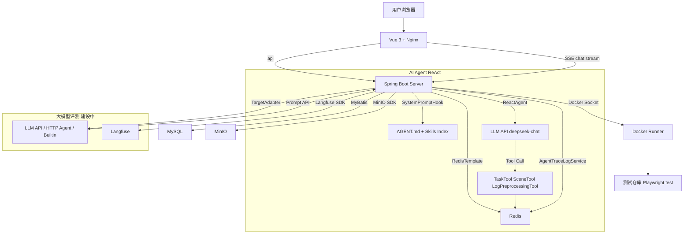

# 智能自动化测试平台

[](https://github.com/MenXiaoHuan/testplatform/actions/workflows/backend-ci.yml)
[](https://github.com/MenXiaoHuan/testplatform/actions/workflows/frontend-ci.yml)
[](https://github.com/MenXiaoHuan/testplatform/actions)
[](LICENSE)
[](DEPLOYMENT.md)

> 面向 **Node.js / TypeScript / JavaScript `@playwright/test`** 项目的**一站式智能自动化测试平台**。
> 覆盖 **UI 自动化测试**（已完成）、**大模型评测**（建设中），未来扩展**性能测试**和**接口自动化**。

---

## ✨ 功能特性

### 🔧 UI 自动化测试（已完成）

- **仓库管理**：Git 地址 / 私有仓库凭据（HTTPS Token · SSH Deploy Key · AES-256-GCM 加密）/ 安装命令 / 执行命令模板
- **场景配置**：关联仓库 · 选择分支 / 浏览器 / 测试选择器 / 环境变量 / Cron 定时规则
- **Docker Runner**：短生命周期容器执行任务，隔离测试依赖 / 限制 CPU / 内存 / 网络，不污染宿主机
- **异步任务编排**：手动触发 · 定时触发 · Agent 对话触发 · 任务取消 · 失败重试
- **产物自动归档**：截图 / 视频 / Trace / 阶段日志 自动上传 MinIO · 统一下载 / 分享链接
- **结果解析**：Playwright JSON reporter → 自动入库为结构化用例结果
- **任务状态机**：QUEUED → RUNNING → SUCCESS/FAILED/CANCELED，含 6 个执行阶段日志

### 🤖 AI 智能助手（已完成）

- **ReAct 循环推理**：Spring AI Alibaba Agent · 思考 → 调用工具 → 观察 → 回答（最多 20 次模型调用熔断）
- **结构化输出**：sections-only（heading / paragraph / list / code / quote / table 六种块）· 省 40-50% Token
- **内置工具集**：TaskTool / SceneTool / RepositoryTool / LogPreprocessingTool / TraceQueryTool
- **Skills 按需加载**：启动时只扫 frontmatter 生成索引，LLM 判断需要时才加载正文（error-analysis / business-knowledge）
- **上下文压缩**：Smart 压缩（LLM 摘要优先，30s 超时 → 规则提取回退）+ Aggressive 压缩
- **全链路 Trace**：Redis 90 天 TTL · 21 个阶段结构化日志 · AOP 拦截真实 Token 用量
- **故障排查**：「帮我分析任务 123 为什么失败了」→ 自动调 TaskTool + LogPreprocessingTool → 输出结构化故障详情
- **SSE 流式**：meta + chunk + complete 事件 · 打字机效果 + fade-in 动画

### 📊 大模型评测（建设中，PRD 已完成）

- **Prompt 托管中心**：Agent 通过平台 API 拉取当前 ACTIVE 版本（ETag 缓存 · P95 ≤ 10ms），Langfuse Trace 自动关联
- **通用被评目标**：LLM API · HTTP Agent · 平台内置 Agent · Python 脚本，适配器模式统一接口
- **离线评测**：固定评测集批量跑批 · 多评分器叠加（规则 / LLM-as-Judge / 代码执行 / 相似度）
- **在线评测**：Langfuse 自动采集所有真实生产请求 → 基于 Trace 配置策略 + 自动评分 + 监控聚合（P50/P95 延迟 / Token / 自动评分分布）
- **A/B 实验**：同一份 Prompt 的不同版本对比 · 跨 Target 对比 · 并行执行 · t 检验 p-value 显著性分析
- **多租户并发**：双层并发限流 + per-Target 共享隔离 + 扫描抖动 + 三层 Judge 预算墙（日预算 → space 预算 → 分钟级 rateLimit）
- **外部评测集接入**：MMLU / HumanEval / GSM8K / TruthfulQA 一键导入

### 🏗️ 平台基础设施

- **RBAC 三角色**：Space 内 ADMIN / DEVELOPER / OBSERVER
- **多租户隔离**：所有业务数据通过 `space_id` 关联，后端强制校验
- **审批流程**：自助注册（可开关）→ 自动创建默认 Space → 申请加入 → Space ADMIN 审批
- **安全基线**：RSA 公钥加密密码传输 · BCrypt 加盐哈希 · AES-256-GCM 凭据加密 · Cookie HttpOnly + SameSite
- **审计日志**：PlatformAuditLog 操作可追溯

---

## 🏗️ 系统架构



### 核心设计决策

| 决策 | 原因 |
|------|------|
| **Docker Runner only**（无宿主机降级路径）| 隔离测试执行环境 · 避免依赖污染 · 支持资源限制 |
| **短事务状态落库**（不包大事务）| Git / Docker / MinIO 都不是数据库事务能回滚的资源 |
| **详情缓存三防**（穿透 / 击穿 / 雪崩）| 空值缓存 + 互斥锁 + TTL 抖动 |
| **Flyway + MyBatis 注解 Mapper**（不用 JPA）| SQL 可控 · 任务状态和分页查询更透明 · 纯注解避免 XML 分散 |
| **sections-only 输出**（不派 response）| LLM 只输出结构化 JSON，后端派生纯文本 · 省 40-50% Token · 避免双写不一致 |
| **Agent Trace 存 Redis**（90 天 TTL）| 比 MySQL 快 · 过期自动清理 · List + ZSet 双索引 |
| **Prompt 托管中心 API 拉取**（不硬编码）| 版本可回滚 · Langfuse Trace 自动关联 Prompt 版本 · A/B 实验强制注入 |

---

## 🚀 快速开始

### 前置要求

| 组件 | 版本 |
|------|------|
| Docker Engine | ≥ 25.0 |
| Docker Compose Plugin | ≥ 2.20 |
| Git | 任意 |

### 5 步启动本地开发环境

```bash
# 1. 克隆代码
git clone https://github.com/MenXiaoHuan/testplatform.git
cd testplatform

# 2. 创建 .env（替换所有 <...> 占位值）
cp .env.example .env
# 编辑 .env，最少要填：PLATFORM_DB_PASSWORD / PLATFORM_REDIS_PASSWORD /
#                      PLATFORM_MINIO_SECRET_KEY / PLATFORM_DEEPSEEK_API_KEY /
#                      PLATFORM_CREDENTIAL_KEY（openssl rand -base64 32）

# 3. 启动所有服务（MySQL + Redis + MinIO + Server + Web）
docker compose up -d --build

# 4. 等健康检查通过（约 60s）
docker compose ps

# 5. 打开浏览器
#    前端：http://localhost:5173
#    后端：http://localhost:8080/api/auth/public-key
```

### 生产部署

```bash
# 完整单机 / 分机 / K8s / 云托管部署指南见 DEPLOYMENT.md
docker compose -f docker-compose.prod.yml up -d --build
```

### 首次创建管理员

```bash
# 临时开启注册
sed -i 's/^PLATFORM_REGISTRATION_ENABLED=.*/PLATFORM_REGISTRATION_ENABLED=true/' .env
docker compose -f docker-compose.prod.yml up -d --force-recreate server

# 浏览器 → http://localhost:5173 → 注册

# 关闭注册并重启
sed -i 's/^PLATFORM_REGISTRATION_ENABLED=.*/PLATFORM_REGISTRATION_ENABLED=false/' .env
docker compose -f docker-compose.prod.yml up -d --force-recreate server
```

---

## 🛠️ 技术栈

| 分层 | 技术 |
|------|------|
| **前端** | Vue 3 · TypeScript · Vite · Pinia · Element Plus · Axios · marked + DOMPurify · highlight.js · Vitest |
| **后端** | Spring Boot 3.5 · Spring Web · MyBatis（注解式）· Flyway · Spring Data Redis |
| **AI Agent** | Spring AI Alibaba Agent 1.1.2 · ReAct 模式 · SSE 流式 |
| **存储** | MySQL 8 · Redis 7 · MinIO（对象存储）|
| **执行** | Docker Runner · Playwright Runner 镜像（`mcr.microsoft.com/playwright`）|
| **工程化** | Docker · Docker Compose · GitHub Actions · JaCoCo |
| **评测（建设中）** | Langfuse（LLM 可观测 + 评测平台）|

> ⚠️ 后端持久层**只使用注解式 MyBatis**，不使用 JPA，不使用 XML Mapper。

---

## 📁 项目结构

```
testplatform/
├── playwright-platform-server/       # Spring Boot 后端
│   ├── src/main/java/.../platform/
│   │   ├── ai/                       # AI Agent 模块
│   │   │   ├── config/               # ReactAgent / DeepSeek / SystemPrompt 配置
│   │   │   ├── controller/           # AgentController（chat / chatStream / trace 查询）
│   │   │   ├── service/              # AgentService（对话主入口）
│   │   │   ├── tools/                # 7 个内置 Tool
│   │   │   ├── hook/                 # SystemPromptHook
│   │   │   ├── skill/                # SkillIndexLoader（按需加载）
│   │   │   ├── session/              # ChatSessionManager（Caffeine + 30min TTL）
│   │   │   ├── output/               # OutputFormatFallbackService（四层兜底）
│   │   │   ├── ModelCallTraceAspect  # AOP 拦截 ChatModel.call()
│   │   │   └── ToolTraceAspect       # AOP 拦截 @Tool 方法
│   │   ├── task/                      # 任务模块（核心）
│   │   ├── runner/                    # Docker Runner 执行器
│   │   ├── scene/                     # 场景 + 定时调度（租约机制）
│   │   ├── repository/                # 仓库 + 私有凭据加密
│   │   ├── space/                     # Space + RBAC + 审批
│   │   ├── auth/                      # 登录注册 + 会话
│   │   ├── storage/                   # MinIO 对象存储
│   │   ├── cache/                     # Redis 详情缓存（穿透/击穿/雪崩三防）
│   │   ├── common/                    # ApiResponse / 异常处理 / 凭据加密
│   │   └── audit/                     # 审计日志
│   └── src/main/resources/
│       ├── AGENT.md                   # Agent 系统提示词
│       ├── application.yml
│       ├── Dockerfile / Dockerfile.dev
│       ├── pom.xml
│       └── db/migration/              # Flyway 迁移（V1~V10）
│
├── playwright-platform-web/          # Vue 3 前端
│   ├── src/
│   │   ├── views/                     # 页面
│   │   │   ├── auth/                  # 登录 / 注册
│   │   │   ├── repository/            # 仓库管理
│   │   │   ├── scene/                 # 场景管理
│   │   │   ├── task/                  # 任务列表 / 详情
│   │   │   ├── event/                 # 调度事件（日志追踪）
│   │   │   ├── ai/                    # Agent Trace 时间线
│   │   │   └── space/                 # 空间审批
│   │   ├── components/ai/             # AiAssistantDialog（AI 对话框）
│   │   ├── stores/                    # Pinia Store（auth · space · task · ai）
│   │   ├── api/                       # API 封装（Axios + 统一响应解包）
│   │   ├── types/                     # DTO 类型定义
│   │   └── utils/                     # 工具函数（artifact / stage-log / task-display / space-permissions）
│   ├── Dockerfile / Dockerfile.dev
│   ├── vite.config.ts
│   └── package.json
│
├── docker-compose.yml                 # 本地开发编排
├── docker-compose.prod.yml            # 单机生产编排
├── .env.example                       # 环境变量模板
├── .github/workflows/                 # CI
│   ├── backend-ci.yml                 # Maven test + JaCoCo
│   └── frontend-ci.yml                # npm test --coverage + build + audit
└── docs/
    ├── prd-01-platform-foundation.md   # 平台基础（登录 / 权限 / Space / 审批）需求文档
    ├── prd-02-ui-automation.md         # UI 自动化模块需求文档
    ├── prd-03-ai-assistant.md          # AI 智能助手需求文档
    └── prd-04-llm-evaluation-prd.md    # 大模型评测模块需求文档（v1.4 · Prompt 托管 + Langfuse + A/B）
```

---

## 📖 文档导航

| 文档 | 说明 |
|------|------|
| 🚀 **快速启动** | 本文档「快速开始」章节 |
| 📦 **部署指南** | [DEPLOYMENT.md](DEPLOYMENT.md)（v2.0 · 单机 / 分机 / K8s / 云托管 · 监控 / CI-CD / 多实例）|
| 📋 **需求文档 · 平台基础** | [docs/prd-01-platform-foundation.md](docs/prd-01-platform-foundation.md)（v1.0 · 登录 / 权限 / Space / 审批）|
| 📋 **需求文档 · UI 自动化** | [docs/prd-02-ui-automation.md](docs/prd-02-ui-automation.md) |
| 📋 **需求文档 · AI 助手** | [docs/prd-03-ai-assistant.md](docs/prd-03-ai-assistant.md) |
| 📋 **需求文档 · 大模型评测** | [docs/prd-04-llm-evaluation-prd.md](docs/prd-04-llm-evaluation-prd.md)（v1.4 · Prompt 托管 + Langfuse + 离线/在线/A/B + 多租户并发）|

---

## 🧪 测试

```bash
# 后端（Maven + JaCoCo）
cd playwright-platform-server
mvn test

# 前端（Vitest + Coverage）
cd playwright-platform-web
npm ci
npm test -- --coverage
npm run build

# CI 自动在每次 push / PR 时执行
# 见 .github/workflows/
```

---

## 🧭 路线图（Roadmap）

| 阶段 | 能力 | 状态 |
|------|------|------|
| **已完成** | UI 自动化测试（仓库 / 场景 / 任务 / Docker Runner / 产物归档）| ✅ |
| **已完成** | AI 智能助手（ReAct / Tools / Skills / Trace / SSE）| ✅ |
| **已完成** | 平台基础（登录 / 权限 / Space / 审批）| ✅ |
| **建设中** | **大模型评测**（Langfuse / Prompt 托管 / 离线 + 在线 + A/B / 多租户并发 / 外部评测集）| 🚧 |
| **规划中** | 性能测试 | 📋 |
| **规划中** | 接口自动化 | 📋 |
| **规划中** | K8s 多实例 + Runner 远程 DinD 调度 | 📋 |
| **规划中** | Grafana + Prometheus 监控大盘上线 | 📋 |

---

## 🤝 贡献指南

欢迎 Issue 和 Pull Request！

1. Fork 本仓库
2. 从 `main` 创建 feature 分支（`git checkout -b feature/my-feature`）
3. 提交变更（`git commit -m 'feat: add my feature'`）
4. 推送到 Fork（`git push origin feature/my-feature`）
5. 提交 Pull Request

### 提交规范

| 前缀 | 用途 |
|------|------|
| `feat:` | 新功能 |
| `fix:` | Bug 修复 |
| `docs:` | 文档变更 |
| `refactor:` | 重构（不改行为）|
| `test:` | 测试相关 |
| `chore:` | 构建 / 工具变更 |

---

## 📄 License

[MIT License](LICENSE)

---

## 📝 项目信息

| 项 | 内容 |
|----|------|
| 仓库 | https://github.com/MenXiaoHuan/testplatform |
| 技术栈 | Vue 3 + Spring Boot 3.5 + Docker + Langfuse（建设中）|
| Runner | **只使用 Docker Runner**（无宿主机降级路径）|
| 测试范围 | Node.js / TypeScript / JavaScript `@playwright/test` 项目 |
| 状态 | 🟢 活跃开发 |
