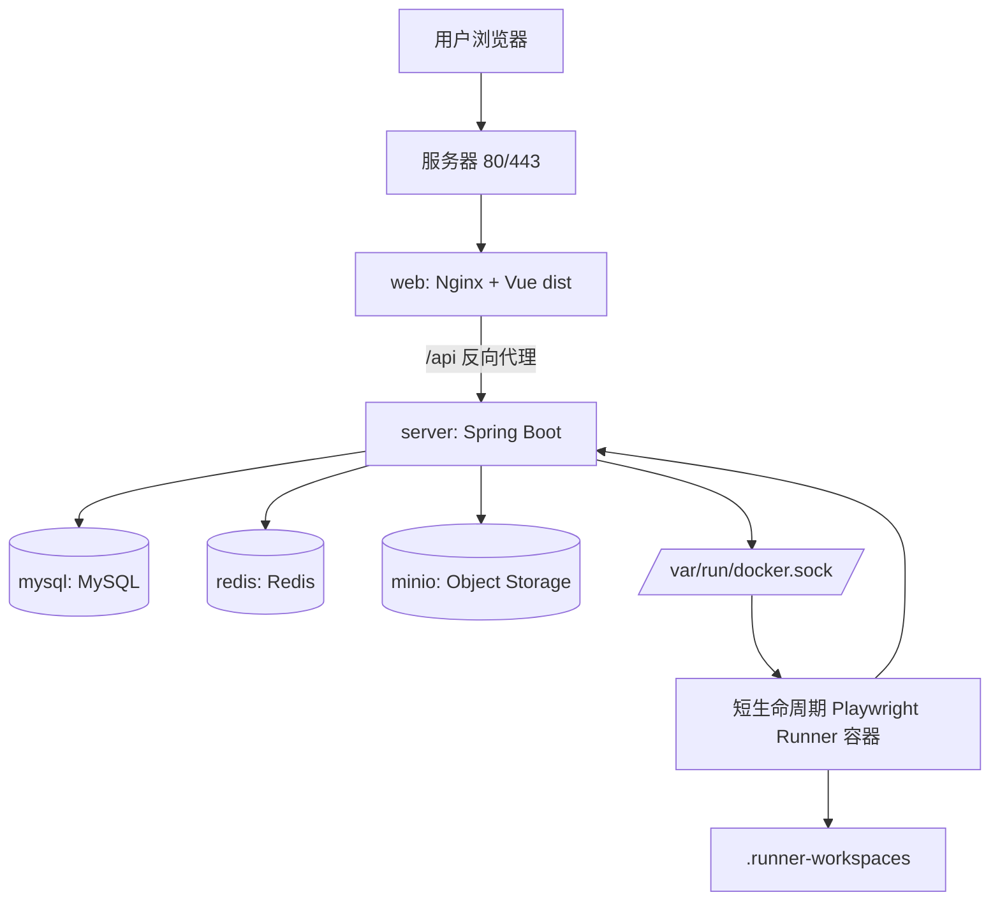

# 单机生产部署指南

本文档说明如何把 Playwright Test Platform 部署到一台 Linux 服务器上。当前推荐先使用 Docker Compose 完成单机生产部署，后续再按团队规模升级到域名、HTTPS、镜像仓库、CI/CD、独立 Runner 和监控体系。

> 平台现在只使用 **Docker Runner**：server 容器通过挂载的 `docker.sock` 启动短生命周期 Playwright 容器执行任务。没有 local runner，也没有宿主机 shell 降级路径。因此部署机必须运行 Docker Engine，且 server 用户必须能访问 Docker socket。

相关文档：

- `docs/docker.md`：说明 `Dockerfile`、`Dockerfile.dev`、`.dockerignore` 与 Compose 的职责划分。
- `docs/guide.md`：项目技术架构总览。

---

## 0. 最短部署流程（TL;DR）

适合一台全新的 Ubuntu 22.04/24.04 服务器：

```bash
# 0) 准备：4C8G+、100GB 磁盘、Docker Engine + Compose、Git
# 1) 拉代码
cd /opt
git clone https://github.com/MenXiaoHuan/testplatform.git
cd testplatform

# 2) 创建环境变量，替换所有 <...> 占位值
cp .env.example .env
nano .env

# 3) 写入宿主机 docker 组 GID
stat -c '%g' /var/run/docker.sock   # 把结果填到 .env 的 DOCKER_GID

# 4) 校验 Compose 能解析
docker compose -f docker-compose.prod.yml config

# 5) 构建并启动
docker compose -f docker-compose.prod.yml up -d --build

# 6) 查看状态和日志
docker compose -f docker-compose.prod.yml ps
docker compose -f docker-compose.prod.yml logs -f server

# 7) 验证 Web / API / Docker Runner
curl -I http://127.0.0.1
curl -s http://127.0.0.1/api/auth/public-key
docker compose -f docker-compose.prod.yml exec server docker version

# 8) 首次注册：临时把 PLATFORM_REGISTRATION_ENABLED 改成 true，
#    重启 server，注册管理员账号，然后再改回 false 并重启。
```

必须确认的 `.env` 值：

- `DOCKER_GID`：宿主机 `/var/run/docker.sock` 的 GID；
- `PLATFORM_DEEPSEEK_API_KEY`：AI 助手 API Key；
- `PLATFORM_MINIO_PUBLIC_ENDPOINT`：浏览器能访问的 MinIO 地址，不能是 `minio:9000`；
- `PLATFORM_RUNNER_HOST_WORKSPACE_ROOT`：宿主机绝对路径；
- `PLATFORM_CREDENTIAL_KEY`：32 字节 base64，用于加密私有仓库凭据；
- `PLATFORM_REGISTRATION_ENABLED=false`：首次建号时临时改 `true`。

---

## 1. 部署架构

### 1.1 单机生产架构图



### 1.2 服务职责

| 服务 | 职责 | 是否建议公网暴露 |
|---|---|---|
| `web` | 托管前端静态资源，并在单机模式下代理 `/api` 到后端 | 是，暴露 `80` 或 `443` |
| `server` | 提供后端 API、任务编排、调度、结果解析和产物归档；通过 Docker Runner 执行任务 | 否，默认只在 Docker 内部网络访问 |
| `mysql` | 保存用户、空间、仓库、场景、任务、用例结果等结构化数据 | 否 |
| `redis` | 保存详情缓存、缓存互斥锁等临时数据 | 否 |
| `minio` | 保存截图、视频、Trace、日志、头像等对象文件 | 可选，只建议限制来源 IP |
| `runner-workspace-init` | 把宿主机 runner workspace 的属主改为容器 UID/GID | 否，一次性初始化容器 |

### 1.3 端口规划

| 端口 | 用途 | 建议 |
|---|---|---|
| `80` | HTTP 访问、证书申请入口 | 必开 |
| `443` | HTTPS 访问 | 正式环境必开 |
| `10000` | MinIO API，映射容器 `9000` | 可选，建议限制来源 IP |
| `10001` | MinIO Console，映射容器 `9001` | 可选，建议限制来源 IP |
| `3306` | MySQL 容器内部端口 | 不要公网开放 |
| `6379` | Redis 容器内部端口 | 不要公网开放 |
| `8080` | 后端容器内部端口 | 不要公网开放 |

---

## 2. 部署前检查清单

| 检查项 | 要求 | 说明 |
|---|---|---|
| 服务器系统 | Ubuntu 22.04 或 Ubuntu 24.04 | 本文命令按 Ubuntu 编写 |
| CPU/内存 | 推荐 4 核 8GB，最低 2 核 4GB | Playwright Runner 会消耗较多资源 |
| 磁盘 | 推荐 100GB，最低 40GB | 任务 workspace 和 MinIO 产物会占用空间 |
| 安全组 | 开放 `80`、`443`，可选开放 `10000`、`10001` | MySQL、Redis 不开放公网 |
| Docker | Docker Engine + Compose Plugin | 平台只使用 Docker Runner，必须能访问 `/var/run/docker.sock` |
| Docker 权限 | 能执行 `docker run` | 需要正确的 `DOCKER_GID`；server 容器以 UID 10001 运行 |
| 镜像仓库 | 能访问 Docker Hub / MCR / Maven / npm | 首次构建需要拉取 `maven`、`eclipse-temurin:21-jre`、`docker:27-cli`、`node`、`nginx`、`mysql`、`redis`、`minio`；网络受限时先配置镜像加速或离线导入镜像 |
| Git | 已安装 | 用于拉取代码和更新版本 |
| `.env` | 已准备生产强密码 | 从 `.env.example` 复制，不提交 GitHub |
| 域名 | 可选 | 没有域名也可先用服务器 IP 跑通 |
| 实例数 | 单实例 | 当前不要启动多个 server 副本 |

---

## 3. 准备服务器

### 3.1 登录服务器

```bash
ssh root@<your-server-ip>
```

### 3.2 更新系统基础包

```bash
apt update
apt install -y ca-certificates curl git openssl
```

### 3.3 创建部署目录

```bash
mkdir -p /opt
cd /opt
```

---

## 4. 安装 Docker

### 4.1 安装 Docker Engine 和 Compose 插件

```bash
install -m 0755 -d /etc/apt/keyrings
curl -fsSL https://download.docker.com/linux/ubuntu/gpg -o /etc/apt/keyrings/docker.asc
chmod a+r /etc/apt/keyrings/docker.asc
echo "deb [arch=$(dpkg --print-architecture) signed-by=/etc/apt/keyrings/docker.asc] https://download.docker.com/linux/ubuntu $(. /etc/os-release && echo "$VERSION_CODENAME") stable" > /etc/apt/sources.list.d/docker.list
apt update
apt install -y docker-ce docker-ce-cli containerd.io docker-buildx-plugin docker-compose-plugin
```

### 4.2 验证安装

```bash
docker --version
docker compose version
docker ps
```

如果 `docker ps` 能正常输出容器列表，说明 Docker 已可用。

---

## 5. 拉取代码

```bash
cd /opt
git clone https://github.com/MenXiaoHuan/testplatform.git
cd testplatform
```

如果服务器已经有旧代码：

```bash
cd /opt/testplatform
git pull
```

---

## 6. 创建生产环境变量

### 6.1 生成强密码

可以在服务器上生成随机密码：

```bash
openssl rand -hex 24
```

建议至少生成三组：

- MySQL root 密码。
- Redis 密码。
- MinIO secret key。

### 6.2 创建 `.env`

```bash
cd /opt/testplatform
cp .env.example .env
nano .env
```

也可以按下面完整示例手写，替换尖括号占位值：

```env
# Frontend
PLATFORM_WEB_HOST_PORT=80

# Backend - 注册与 AI
# 默认关闭注册；首次部署临时设为 true 创建账号，完成后改回 false。
PLATFORM_REGISTRATION_ENABLED=false
PLATFORM_DEEPSEEK_API_KEY=<your-deepseek-api-key>
PLATFORM_DEEPSEEK_BASE_URL=https://api.deepseek.com
PLATFORM_DEEPSEEK_MODEL=deepseek-chat

# Backend - MySQL
PLATFORM_DB_NAME=playwright_platform
PLATFORM_DB_URL=jdbc:mysql://mysql:3306/playwright_platform?useSSL=false&allowPublicKeyRetrieval=true&createDatabaseIfNotExist=true&serverTimezone=UTC
PLATFORM_DB_USERNAME=root
PLATFORM_DB_PASSWORD=<your-db-password>

# Backend - Redis
PLATFORM_REDIS_HOST=redis
PLATFORM_REDIS_PORT=6379
PLATFORM_REDIS_PASSWORD=<your-redis-password>

# Backend - MinIO
PLATFORM_MINIO_ENDPOINT=http://minio:9000
# 浏览器能访问到的 MinIO 地址；头像预签名 URL 使用这个地址。
# 如果 MinIO 不暴露公网，可改成 https://<your-domain>/minio 并配置反向代理。
PLATFORM_MINIO_PUBLIC_ENDPOINT=https://<your-domain>/minio
PLATFORM_MINIO_API_HOST_PORT=10000
PLATFORM_MINIO_CONSOLE_HOST_PORT=10001
PLATFORM_MINIO_ACCESS_KEY=<your-minio-access-key>
PLATFORM_MINIO_SECRET_KEY=<your-minio-secret-key>
PLATFORM_STORAGE_BUCKET=qa-report

# Backend - Runner
# 宿主机 docker 组 GID：stat -c '%g' /var/run/docker.sock
DOCKER_GID=999
PLATFORM_RUNNER_WORKSPACE_ROOT=/runner-workspaces
PLATFORM_RUNNER_HOST_WORKSPACE_ROOT=/opt/testplatform/.runner-workspaces
PLATFORM_RUNNER_DOCKER_IMAGE=mcr.microsoft.com/playwright:v1.61.1-noble
PLATFORM_RUNNER_DOCKER_NETWORK=bridge
PLATFORM_RUNNER_DOCKER_MEMORY=2g
PLATFORM_RUNNER_DOCKER_CPUS=2
PLATFORM_RUNNER_DOCKER_CONTAINER_WORKSPACE_ROOT=/workspace/task

# Backend - 容量 / AI 保护（可选，按机器调整）
PLATFORM_TASK_CORE_POOL_SIZE=2
PLATFORM_TASK_MAX_POOL_SIZE=4
PLATFORM_TASK_QUEUE_CAPACITY=50
PLATFORM_TASK_RETENTION_DAYS=90
PLATFORM_AI_DAILY_LIMIT=50
PLATFORM_AI_MAX_CONCURRENT=4

# 私有仓库凭据加密与服务器级 Git 设置
PLATFORM_CREDENTIAL_KEY=<32-byte-base64>
PLATFORM_GIT_KNOWN_HOSTS_PATH=
PLATFORM_GIT_SUBMODULES_ENABLED=false
PLATFORM_GIT_LFS_ENABLED=false

# 阶段日志（可选）
PLATFORM_RUNNER_MAX_TEST_LOG_BYTES=209715200
```

### 6.3 变量说明

| 变量 | 作用 | 是否敏感 | 生产建议 |
|---|---|---|---|
| `PLATFORM_WEB_HOST_PORT` | 前端 Web 对外端口 | 否 | 没接 HTTPS 前可用 `80` |
| `PLATFORM_DB_NAME` | MySQL 数据库名 | 否 | 默认 `playwright_platform` |
| `PLATFORM_DB_URL` | 后端连接 MySQL 的 JDBC URL | 否 | 使用 Docker 内部主机名 `mysql` |
| `PLATFORM_DB_USERNAME` | MySQL 用户名 | 是 | 单机初期可用 `root` |
| `PLATFORM_DB_PASSWORD` | MySQL 密码 | 是 | 使用强随机密码 |
| `PLATFORM_REDIS_HOST` | Redis 主机名 | 否 | Compose 内使用 `redis` |
| `PLATFORM_REDIS_PORT` | Redis 容器内部端口 | 否 | 保持 `6379` |
| `PLATFORM_REDIS_PASSWORD` | Redis 密码 | 是 | 使用强随机密码 |
| `PLATFORM_MINIO_ENDPOINT` | 后端访问 MinIO 的地址 | 否 | Compose 内保持 `http://minio:9000` |
| `PLATFORM_MINIO_API_HOST_PORT` | MinIO API 宿主机端口 | 否 | 当前建议 `10000` |
| `PLATFORM_MINIO_CONSOLE_HOST_PORT` | MinIO Console 宿主机端口 | 否 | 当前建议 `10001` |
| `PLATFORM_MINIO_ACCESS_KEY` | MinIO 用户名 | 是 | 不要使用默认弱口令 |
| `PLATFORM_MINIO_SECRET_KEY` | MinIO 密码 | 是 | 使用强随机密码 |
| `PLATFORM_STORAGE_BUCKET` | 产物 bucket | 否 | 默认 `qa-report` |
| `PLATFORM_MINIO_PUBLIC_ENDPOINT` | 浏览器可访问的 MinIO 地址 | 否 | 头像预签名 URL 使用；不能填 `minio:9000` |
| `PLATFORM_REGISTRATION_ENABLED` | 是否开放自助注册 | 否 | 默认 `false`；首次建号临时改 `true` |
| `PLATFORM_DEEPSEEK_API_KEY` | AI 助手 API Key | 是 | 必填，否则 AI 功能不可用 |
| `DOCKER_GID` | 宿主机 docker 组 GID | 否 | `stat -c '%g' /var/run/docker.sock` 获取 |
| `PLATFORM_RUNNER_WORKSPACE_ROOT` | 容器内 runner workspace | 否 | 通常保持 `/runner-workspaces` |
| `PLATFORM_RUNNER_HOST_WORKSPACE_ROOT` | 宿主机 runner workspace | 否 | **必须是绝对路径**，如 `/opt/testplatform/.runner-workspaces` |
| `PLATFORM_RUNNER_DOCKER_IMAGE` | Playwright Runner 镜像 | 否 | 必须和测试仓库的 Playwright 版本匹配 |
| `PLATFORM_RUNNER_DOCKER_MEMORY` | Runner 内存限制 | 否 | 默认 `2g`；4C8G 主机建议不要并发超过 2 个 |
| `PLATFORM_RUNNER_DOCKER_CPUS` | Runner CPU 限制 | 否 | 默认 `2`；按服务器规格调整 |
| `PLATFORM_TASK_CORE_POOL_SIZE` | 任务池核心线程数 | 否 | 稳态并发数；`core < max` 时平时只跑 core 个 |
| `PLATFORM_TASK_MAX_POOL_SIZE` | 任务池最大线程数 | 否 | 峰值并发上限；4C8G 建议 2，8C16G 建议 4 |
| `PLATFORM_TASK_QUEUE_CAPACITY` | 任务排队上限 | 否 | 默认 50；队列满后任务直接失败 |
| `PLATFORM_TASK_RETENTION_DAYS` | 任务数据保留天数 | 否 | 0 表示不清理；生产建议 90 |
| `PLATFORM_AI_DAILY_LIMIT` | 每用户每天 AI 次数 | 否 | 默认 50，按成本调整 |
| `PLATFORM_AI_MAX_CONCURRENT` | AI 同时调用数 | 否 | 默认 4 |
| `PLATFORM_CREDENTIAL_KEY` | 仓库凭据 AES-GCM 加密密钥 | 是 | 32 字节 base64；私有仓库必填 |
| `PLATFORM_GIT_KNOWN_HOSTS_PATH` | SSH known_hosts 路径 | 否 | 服务器级 SSH host key 校验 |
| `PLATFORM_GIT_SUBMODULES_ENABLED` | 是否拉取 submodule | 否 | 默认 `false` |
| `PLATFORM_GIT_LFS_ENABLED` | 是否下载 Git LFS | 否 | 默认 `false`；镜像已带 `git-lfs` |
| `PLATFORM_RUNNER_MAX_TEST_LOG_BYTES` | 测试阶段日志上限 | 否 | 默认 200MB |

### 6.4 注意事项

- `.env` 是服务器私有文件，不提交 GitHub。
- 生产 Compose 不读取 `PLATFORM_SERVER_HOST_PORT`、`PLATFORM_MYSQL_HOST_PORT`、`PLATFORM_REDIS_HOST_PORT` 和 `PLATFORM_WEB_API_PROXY_TARGET`。
- `PLATFORM_MINIO_ENDPOINT` 使用 Docker 内部地址，不要改成宿主机端口 `10000`；`PLATFORM_MINIO_PUBLIC_ENDPOINT` 才是浏览器访问地址。
- 如果暂时不配置域名反向代理，可以先用 `PLATFORM_MINIO_PUBLIC_ENDPOINT=http://<server-ip>:10000`，并在安全组/防火墙限制来源 IP；正式环境建议改成 HTTPS 域名。
- MySQL、Redis、MinIO 第一次初始化后，修改 `.env` 密码不会自动修改已有 Docker volume 内的账号密码。
- **平台只使用 Docker Runner**：server 容器必须能访问 `/var/run/docker.sock`，启动时会执行 `docker version` 预检；Docker 不可用时 server 直接启动失败。
- `DOCKER_GID` 必须匹配宿主机 `/var/run/docker.sock` 的属组，否则 server 容器内没有权限执行 `docker run`。`runner-workspace-init` 会在启动时把 workspace 目录 chown 给容器用户，首次启动必须让它成功完成。
- 生产 Compose 默认 `PLATFORM_REGISTRATION_ENABLED=false`。首次部署时临时设为 `true` 创建管理员账号，创建完成后改回 `false` 并重启 server。
- `PLATFORM_DEEPSEEK_API_KEY` 为空时 AI 助手会持续报错；如果暂时不用 AI，可以忽略，但不要把它暴露给不可信用户。
- **当前只支持单实例 server**：`TaskRecoveryService` 启动时会把遗留的 RUNNING 任务标记失败，不要同时启动两个 server 副本。需要横向扩容时，要先改成基于任务所有权/心跳的恢复机制。
- `docker-compose.prod.yml` 的 `server` 使用 `env_file: .env`，所以 `.env` 里新增的池/超时/配额配置会真正注入容器；`environment` 中同名项优先。

---

## 7. 启动生产服务

### 7.1 检查 Compose 配置

```bash
docker compose -f docker-compose.prod.yml config
```

如果 `.env` 缺少必填变量，命令会直接报错。

### 7.2 启动服务

```bash
docker compose -f docker-compose.prod.yml up -d --build
```

首次启动会构建前后端镜像并拉取 MySQL、Redis、MinIO 镜像，耗时取决于服务器网络。生产后端镜像还需要能拉取 `docker:27-cli`（用于 Docker Runner）和 `eclipse-temurin:21-jre`；如果服务器无法访问 Docker Hub，请先配置镜像加速器或在其他机器构建后 `docker save` / `docker load` 导入。

### 7.3 查看容器状态

```bash
docker compose -f docker-compose.prod.yml ps -a
```

期望看到：

- `mysql` 为 `healthy`。
- `redis` 为 `healthy`。
- `minio` 为 `healthy`。
- `runner-workspace-init` 为 `exited (0)`，表示 workspace 属主修正成功。
- `server` 为 `running`，且日志出现 `Docker runner preflight passed`。
- `web` 为 `running`。

### 7.4 查看日志

查看后端日志：

```bash
docker compose -f docker-compose.prod.yml logs -f server
```

查看前端日志：

```bash
docker compose -f docker-compose.prod.yml logs -f web
```

查看所有日志：

```bash
docker compose -f docker-compose.prod.yml logs -f
```

---

## 8. 验证部署结果

### 8.1 浏览器访问

如果 `PLATFORM_WEB_HOST_PORT=80`，浏览器访问：

```text
http://<your-server-ip>
```

如果已经配置域名和 HTTPS，访问：

```text
https://test-platform.example.com
```

### 8.2 命令行验证

验证前端入口：

```bash
curl -I http://127.0.0.1
```

验证后端接口是否能通过前端 Nginx 代理访问：

```bash
curl -s http://127.0.0.1/api/auth/public-key
```

验证 server 容器内的 Docker Runner 预检：

```bash
docker compose -f docker-compose.prod.yml exec server docker version
```

期望输出包含 Docker Client 和 Server 版本。如果这里失败，任务一定无法执行。

验证 MinIO Console 端口是否打开：

```bash
curl -I http://127.0.0.1:10001
```

验证数据库表是否创建：

```bash
docker compose -f docker-compose.prod.yml exec mysql \
  mysql -uroot -p"$PLATFORM_DB_PASSWORD" -D "$PLATFORM_DB_NAME" \
  -e "SHOW TABLES;"
```

验证 Redis 密码：

```bash
docker compose -f docker-compose.prod.yml exec redis \
  redis-cli -a "$PLATFORM_REDIS_PASSWORD" ping
```

期望输出：

```text
PONG
```

### 8.3 页面功能验证

| 验证项 | 期望结果 |
|---|---|
| 打开前端页面 | 页面正常加载 |
| 注册/登录 | 用户可进入系统 |
| 创建仓库 | 数据保存成功 |
| 创建场景 | 能关联仓库并保存配置 |
| 手动执行任务 | 任务进入队列并开始执行 |
| 查看任务详情 | 状态、用例、日志、产物可查看 |
| 上传产物 | MinIO 中能看到对象文件 |
| 后端日志 | 无 MySQL、Redis、MinIO 连接错误；出现 `Docker runner preflight passed` |

首次创建账号：

```bash
# 1) 临时开放注册
sed -i 's/^PLATFORM_REGISTRATION_ENABLED=.*/PLATFORM_REGISTRATION_ENABLED=true/' .env
docker compose -f docker-compose.prod.yml up -d --force-recreate server

# 2) 浏览器注册管理员账号

# 3) 关闭注册并重启
sed -i 's/^PLATFORM_REGISTRATION_ENABLED=.*/PLATFORM_REGISTRATION_ENABLED=false/' .env
docker compose -f docker-compose.prod.yml up -d --force-recreate server
```

---

## 9. 日常更新

### 9.1 更新到最新代码

```bash
cd /opt/testplatform
git pull
docker compose -f docker-compose.prod.yml up -d --build
```

### 9.2 查看当前版本

```bash
git rev-parse --short HEAD
git log -1 --oneline
```

### 9.3 只重启服务

```bash
docker compose -f docker-compose.prod.yml restart
```

### 9.4 只重启后端

```bash
docker compose -f docker-compose.prod.yml restart server
```

### 9.5 只重启前端

```bash
docker compose -f docker-compose.prod.yml restart web
```

---

## 10. 停止、清理和重置

### 10.1 停止服务但保留数据

```bash
docker compose -f docker-compose.prod.yml down
```

### 10.2 清理构建缓存

```bash
docker builder prune
```

### 10.3 删除所有数据并重新初始化

危险操作，会删除 MySQL、Redis、MinIO 数据：

```bash
docker compose -f docker-compose.prod.yml down -v
```

只有在测试环境或明确要重置生产数据时才执行。

---

## 11. 数据备份与恢复

### 11.1 需要备份什么

| 数据 | 位置 | 说明 |
|---|---|---|
| MySQL 业务数据 | Docker volume `mysql-data` | 用户、空间、仓库、场景、任务、结果 |
| Redis 数据 | Docker volume `redis-data` | 缓存和临时数据，重要性低于 MySQL |
| MinIO 产物 | Docker volume `minio-data` | 截图、视频、Trace、日志、头像 |
| Runner workspace | `.runner-workspaces` | 任务运行工作区，可按需清理 |
| 环境变量 | `.env` | 密码和部署配置，必须安全备份 |

### 11.2 MySQL 备份

```bash
mkdir -p /opt/backups/testplatform
docker compose -f docker-compose.prod.yml exec mysql \
  mysqldump -uroot -p"$PLATFORM_DB_PASSWORD" "$PLATFORM_DB_NAME" \
  > /opt/backups/testplatform/mysql-$(date +%F-%H%M%S).sql
```

### 11.3 MySQL 恢复

```bash
docker compose -f docker-compose.prod.yml exec -T mysql \
  mysql -uroot -p"$PLATFORM_DB_PASSWORD" "$PLATFORM_DB_NAME" \
  < /opt/backups/testplatform/<backup-file>.sql
```

### 11.4 MinIO 和 Redis 备份

单机最简单方式是停机后打包 Docker volume 数据目录，正式生产建议使用云盘快照或对象存储复制策略。

```bash
docker compose -f docker-compose.prod.yml down
tar -czf /opt/backups/testplatform/runner-workspaces-$(date +%F-%H%M%S).tar.gz .runner-workspaces
docker compose -f docker-compose.prod.yml up -d
```

如果使用云服务器，优先使用云盘快照备份 Docker 数据目录。

---

## 12. 回滚方案

### 12.1 回滚到上一个 Git 提交

查看最近提交：

```bash
git log --oneline -5
```

切换到指定提交：

```bash
git checkout <commit-sha>
docker compose -f docker-compose.prod.yml up -d --build
```

确认恢复后，如果要回到 `main` 最新版本：

```bash
git checkout main
git pull
docker compose -f docker-compose.prod.yml up -d --build
```

### 12.2 回滚前注意

- 如果新版本已经执行了数据库迁移，代码回滚不一定能自动回滚 schema。
- 生产更新前建议先备份 MySQL。
- 如果只是前端页面问题，优先只回滚前端镜像或代码。

---

## 13. 域名和 HTTPS

### 13.1 推荐域名

正式给团队使用时，推荐前后端分域名：

```text
https://test-platform.example.com
https://api.test-platform.example.com
```

| 域名 | 指向 | 说明 |
|---|---|---|
| `test-platform.example.com` | 前端入口 | 用户访问页面 |
| `api.test-platform.example.com` | 后端 API | 后续可独立限流、监控、扩容 |

### 13.2 当前 Compose 与分域名的关系

当前 `docker-compose.prod.yml` 先保证单机可运行：

- `web` 容器暴露 `80`。
- 前端 Nginx 会把 `/api` 代理给 `server:8080`。
- 这种模式不需要额外 CORS。

正式分域名时需要补充：

- DNS：两个域名都解析到服务器公网 IP。
- HTTPS：证书覆盖两个域名。
- 前端：支持 `VITE_API_BASE_URL=https://api.test-platform.example.com`。
- 后端：配置 CORS，只允许可信前端域名访问。
- 反向代理：使用 Caddy 或 Nginx 分别代理前端和 API。

### 13.3 Caddy 方向示例

如果后续引入 Caddy，可参考方向：

```caddyfile
test-platform.example.com {
    reverse_proxy web:80
}

api.test-platform.example.com {
    reverse_proxy server:8080
}
```

该示例只是方向说明，正式接入时需要结合实际网络、证书、Compose 网络和 CORS 配置调整。

---

## 14. 常见问题排查

### 14.1 Compose 配置报缺少变量

现象：

```text
Set PLATFORM_DB_PASSWORD in .env
```

处理：

- 检查 `.env` 是否在项目根目录。
- 检查变量名是否拼写正确。
- 执行 `docker compose -f docker-compose.prod.yml config` 验证。

### 14.2 MySQL 密码不一致

现象：

- `mysql` 容器启动正常，但 `server` 连不上数据库。
- 修改 `.env` 密码后仍然认证失败。

原因：

- MySQL 第一次初始化后，root 密码保存在 volume 内。
- 后续修改 `.env` 不会自动修改已有 volume 里的密码。

处理：

- 生产环境：优先改回原密码。
- 测试环境：可执行 `docker compose -f docker-compose.prod.yml down -v` 重建数据卷。

### 14.3 Redis 认证失败

现象：

```text
NOAUTH Authentication required
```

处理：

```bash
docker compose -f docker-compose.prod.yml exec redis \
  redis-cli -a "$PLATFORM_REDIS_PASSWORD" ping
```

如果密码不一致，需要检查 `.env` 和 Redis volume 初始化状态。

### 14.4 MinIO 登录失败

处理：

- 确认使用 `PLATFORM_MINIO_ACCESS_KEY` 和 `PLATFORM_MINIO_SECRET_KEY` 登录。
- 确认访问的是 Console 端口 `10001`，不是 API 端口 `10000`。
- 确认安全组开放了 `10001`，且来源 IP 被允许。

### 14.5 `runner-workspace-init` 没有成功完成

查看日志：

```bash
docker compose -f docker-compose.prod.yml logs runner-workspace-init
```

常见原因：

- `PLATFORM_RUNNER_HOST_WORKSPACE_ROOT` 不是绝对路径，或宿主机目录不存在。
- 宿主机用户没有权限修改该目录。
- `DOCKER_GID` 不是数字，导致 `chown` 失败。

处理：

- 改成绝对路径，例如 `/opt/testplatform/.runner-workspaces`。
- 手动预创建目录：
  ```bash
  mkdir -p /opt/testplatform/.runner-workspaces
  ```
- 确认 `.env` 中的 `DOCKER_GID`：
  ```bash
  stat -c '%g' /var/run/docker.sock
  ```
- 修改后重新执行：
  ```bash
  docker compose -f docker-compose.prod.yml up -d --build
  ```

### 14.6 Docker Runner 预检失败

现象：

`server` 启动失败，日志中出现：

```text
Docker runner preflight failed
```

或：

```text
Docker runner requires the `docker` CLI in PATH
```

处理：

```bash
# 宿主机 Docker 是否正常
docker version

# server 容器内是否有 CLI、是否能访问 socket
docker compose -f docker-compose.prod.yml exec server docker version
```

重点检查：

- `DOCKER_GID` 是否等于 `stat -c '%g' /var/run/docker.sock`；
- `docker-compose.prod.yml` 是否挂载了 `/var/run/docker.sock`；
- 生产镜像是否包含 Docker CLI（当前 `Dockerfile` 已从 `docker:27-cli` 复制）；
- 宿主机 Docker daemon 是否运行。

平台没有 local runner 降级路径，预检失败时必须先修 Docker，不能靠切换模式绕过。

### 14.7 后端启动失败

查看日志：

```bash
docker compose -f docker-compose.prod.yml logs --tail=200 server
```

重点检查：

- MySQL 连接错误。
- Redis 密码错误。
- MinIO endpoint 或账号密码错误。
- Flyway 迁移失败。
- Runner workspace 权限问题。

### 14.8 Runner 执行失败

平台现在只有 Docker Runner，排查顺序：

```bash
# 1) server 启动预检是否通过
docker compose -f docker-compose.prod.yml logs --tail=100 server | grep -i docker

# 2) server 容器内 Docker 是否可用
docker compose -f docker-compose.prod.yml exec server docker version

# 3) runner 镜像是否存在
docker compose -f docker-compose.prod.yml exec server docker image inspect "$PLATFORM_RUNNER_DOCKER_IMAGE"

# 4) workspace 权限
docker compose -f docker-compose.prod.yml exec server ls -ld /runner-workspaces
```

重点检查：

- 服务器是否能拉取 `PLATFORM_RUNNER_DOCKER_IMAGE`。
- `server` 是否挂载 `/var/run/docker.sock`，且 `DOCKER_GID` 正确。
- `/runner-workspaces` 是否可写。
- 服务器 CPU、内存是否不足；每个任务默认 `2g / 2 CPU`。
- 测试仓库的安装命令和执行命令是否正确。
- 没有 local runner 降级路径；Docker 不可用时任务无法执行。

### 14.9 端口被占用

检查端口：

```bash
ss -lntp | grep ':80'
ss -lntp | grep ':10000'
ss -lntp | grep ':10001'
```

处理：

- 停止占用端口的服务。
- 或修改 `.env` 中对应端口。

---

## 15. 安全注意事项

| 风险 | 建议 |
|---|---|
| `.env` 泄露 | 不提交 GitHub，只在服务器保存 |
| MySQL/Redis 暴露公网 | 不开放相关端口 |
| MinIO Console 暴露公网 | 限制来源 IP，使用强密码 |
| Docker socket 权限高 | 只部署在受控服务器；平台只使用 Docker Runner，不提供宿主机 shell 降级 |
| 单实例限制 | 不要启动多个 server 副本；当前恢复逻辑会把其他实例的 RUNNING 任务标记失败 |
| HTTP 明文访问 | 正式环境配置 HTTPS |
| 弱口令 | 所有密码使用随机强密码 |
| 数据丢失 | 定期备份 MySQL、MinIO 和 `.env` |
| 镜像过旧 | 定期更新基础镜像和系统补丁 |

---

## 16. 部署讲解要点

可以这样介绍部署设计：

> 这个项目使用 Docker Compose 做单机生产部署。Compose 编排 MySQL、Redis、MinIO、Spring Boot 后端和 Vue/Nginx 前端。生产环境使用多阶段 Dockerfile，后端构建成 jar 后用 JRE + Docker CLI 运行，前端构建成 dist 后由 Nginx 托管。平台只使用 Docker Runner：server 通过挂载的 docker.sock 启动短生命周期 Playwright 容器执行任务，没有宿主机 shell 降级路径。敏感配置全部放在服务器私有 `.env`，不提交代码库。MySQL、Redis、后端只在 Docker 内部网络访问，外部主要暴露前端入口和可选的 MinIO 管理端口。部署文档还覆盖了 Docker 预检、workspace 属主初始化、数据备份、版本回滚、域名 HTTPS 和常见问题排查。

---

## 17. 最小部署命令汇总

如果已经完成服务器、Docker 和 `.env` 准备，最小启动流程如下：

```bash
cd /opt/testplatform
docker compose -f docker-compose.prod.yml config
docker compose -f docker-compose.prod.yml up -d --build
docker compose -f docker-compose.prod.yml ps
docker compose -f docker-compose.prod.yml logs -f server
# 另开终端验证 Docker Runner
docker compose -f docker-compose.prod.yml exec server docker version
```

浏览器访问：

```text
http://<your-server-ip>
```

---

## 18. 私有仓库与自定义 Playwright 项目

### 18.1 当前支持范围

平台面向 **`@playwright/test` + Playwright JSON reporter** 的项目：

- Git 仓库可以 clone；
- 有安装命令（如 `npm ci`）；
- 测试命令能运行 Playwright Test；
- 结果 JSON 路径可配置（`resultsIndexRelativePath`）；
- 产物目录可配置（`artifactRootRelativePath`）。

Python Playwright、Java/.NET Playwright、Cucumber、CodeceptJS 等不是默认支持范围；可以运行命令，但用例结果解析和产物绑定不可用。

命令模板支持：

```text
{target}    # testRoot + matchValue，已做 shell 转义
{project}   # 场景 browser，已做 shell 转义
{testRoot}  # 仓库 testRoot，已做 shell 转义
```

例如：

```text
npm run test:e2e -- {target} --project {project}
```

占位符会作为完整参数做 shell 转义，不要写成 `{testRoot}/foo.spec.ts` 这种拼接形式。包含占位符时平台只做替换，不再自动追加参数；不含占位符的自定义命令原样执行，只有 Playwright CLI（`npx/pnpm/yarn/npm exec playwright test`）仍会自动追加 target/project。

### 18.2 在仓库管理中配置私有凭据

私有仓库凭据属于仓库，不属于场景。场景只负责选择仓库、测试文件和浏览器。

新增/编辑仓库时：

```text
仓库类型：公有 / 私有

私有仓库认证方式：
  HTTPS Token
    用户名（可选，默认 x-access-token）
    Token / Password

  SSH Deploy Key
    私钥内容（推荐无口令只读 key）
```

保存后：

- 凭据使用 AES-256-GCM 加密后存入 MySQL；
- API 不返回明文，只返回 `credentialConfigured`；
- 编辑时凭据输入框为空，留空表示保持原凭据；
- 切换到公有仓库会清除凭据。

场景页面会检查所选仓库：

- 私有仓库未配置凭据时，显示提示并阻止保存；
- 已配置时正常保存，但凭据本身不会下发到前端。

### 18.3 凭据加密密钥

生产必须在 `.env` 配置：

```env
PLATFORM_CREDENTIAL_KEY=<32 字节 base64>
```

生成方式：

```bash
openssl rand -base64 32
```

注意：

- 这个 key 不提交 Git，不放进镜像；
- 更换 key 后旧凭据无法解密，需要重新保存所有私有仓库凭据；
- 未配置 key 时公有仓库不受影响，保存私有仓库凭据会明确报错；
- 不要把 token 放进 Git URL。平台已拒绝 `https://token@host/...` 形式。

### 18.4 私有 npm 依赖

如果测试仓库依赖私有 npm 包：

- 在仓库里使用 `.npmrc` 引用环境变量，例如
  `//registry.npmjs.org/:_authToken=${NPM_TOKEN}`；
- 在场景的环境变量 JSON 里传 `NPM_TOKEN`；
- 使用只读、最小权限 token；
- 不要把 token 写进 `installCommand`，否则会进入阶段日志的 command 字段；
- 阶段日志和错误消息会做常见凭据脱敏，但测试代码主动打印的内容仍需自行控制。

### 18.5 submodule 和 Git LFS 开关

默认关闭，按服务器需要打开：

```env
PLATFORM_GIT_SUBMODULES_ENABLED=true
PLATFORM_GIT_LFS_ENABLED=true
PLATFORM_GIT_KNOWN_HOSTS_PATH=/home/appuser/.ssh/known_hosts
```

- submodule：clone 时追加 `--recurse-submodules --shallow-submodules`；
- LFS：生产镜像已安装 `git-lfs` 并执行 `git lfs install --system`；关闭时设置 `GIT_LFS_SKIP_SMUDGE=1`；
- SSH 私有仓库需要把服务器 host key 放进 known_hosts；
- 这些是服务器级开关，不是每个仓库单独配置。

### 18.6 当前限制

- 平台只承诺支持 Node/TS/JS 的 `@playwright/test` 项目和 Playwright JSON reporter；
- Python、Java/.NET Playwright、Cucumber、CodeceptJS 等不在默认支持范围；
- Git URL 只允许 `https` / `ssh` / `git@host:path`，拒绝 `http://`、HTTPS userinfo 和字面量私网 IP；
- clone 使用 `--depth 1 --single-branch`；submodule/LFS 需要显式打开；
- SSH 私钥在浏览器中提交，建议只使用无口令、只读 Deploy Key；
- Docker Runner 镜像如果来自私有 registry，需要先让宿主机 Docker 登录该 registry。

## 19. 阶段日志说明

| 阶段 | 是否记录 | 说明 |
|---|---|---|
| `PREPARING` | 摘要 + git clone 输出 | 记录任务接收、branch、workspace、执行目录、结果路径，并追加 clone 输出（最多 256KB） |
| `INSTALLING` | 完整命令输出 | 合并 stdout/stderr，包含镜像 pull 输出；默认上限 50MB |
| `TESTING` | 完整命令输出 | 合并 stdout/stderr；默认上限 200MB |
| `ARCHIVING` | 独立阶段日志 | 记录解析结果数、artifact binding 数、跳过原因、归档成功/失败 |

补充：

- `PLATFORM_RUNNER_MAX_LOG_BYTES` 控制安装/准备阶段，默认 50MB；`PLATFORM_RUNNER_MAX_TEST_LOG_BYTES` 控制测试阶段，默认 200MB。
- 超过上限后继续读取管道但不再落盘，日志末尾会写 `[log truncated...]`。因此“完整”只在这个上限内成立。
- 阶段日志全文在 MinIO，前端列表只展示前 512 字符预览；下载走后端代理接口。
- 镜像 pull 失败会保留 pull 日志并作为 `INSTALLING` 失败结果归档。
- 归档上传失败时，临时日志会被删除，阶段日志可能缺失；任务详情里的错误摘要仍可辅助排查。
